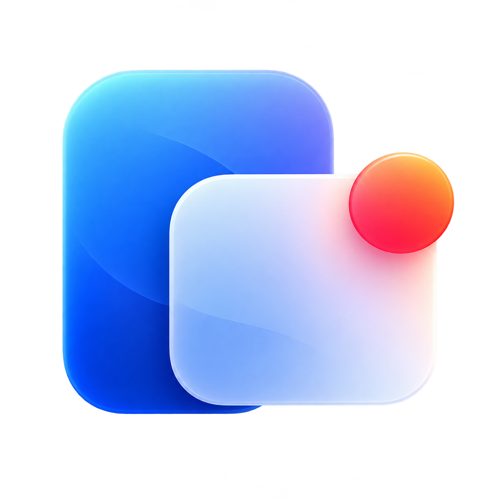

# Phone Check



Your Android notifications, in your Mac menu bar. Read rich previews, reply, use
notification and media controls, and dismiss on your phone with confirmation.
The header shows phone battery, charging, and Battery Saver.

```text
Android phone  ←── encrypted pairing ──→  Mac menu bar
               Same Wi-Fi · no account
               Optional Google sign-in → Firebase fallback
```

One phone, one Mac. No notification history. Native Compose / Material 3 on Android;
SwiftUI on macOS, with Liquid Glass on macOS 26+.

## Build & install

| | Android | macOS |
|---|---|---|
| Runs on | Android 11+ | macOS 14+ |
| Build tools | Android Studio, JDK 17+ bootstrap, SDK 37, Build Tools 36.0.0 | Xcode command-line tools with macOS 27 SDK |

Supply your own ignored client configuration before building, even for local-only
use: `android/app/google-services.json`, `macos/GoogleService-Info.plist`, and
`macos/GoogleOAuthClient.json`. See [Firebase setup](firebase/README.md#project-and-client-configuration).
Never commit credentials or configuration files. Gradle provisions its pinned JDK 25 daemon.

**Android** — connect a phone with USB debugging enabled:

```sh
cd android
./gradlew :app:assembleDebug :app:installDebug
```

Or open `android/` in Android Studio and Run. APK: `android/app/build/outputs/apk/debug/app-debug.apk`.

**Mac** — from the repository root:

```sh
./scripts/build-macos.sh
cp -R "macos/build/Phone Check.app" /Applications/
open "/Applications/Phone Check.app"
```

Local Mac builds are ad hoc signed. Set `SIGNING_IDENTITY` to an Apple-issued
identity for stable local-network permission and release Keychain access.
Release signing for Android and Mac distribution/notarization are not configured.

## Pair

1. Open Phone Check from the Mac menu bar → **Pair phone**.
2. On Android, **Scan QR code** or **Enter code instead**.
3. Allow Android notification access and local-network access when requested.
   Sideloaded apps may first need **Allow restricted settings** in system app settings.

Stay signed out and use the same Wi-Fi for local-only sync. For cloud fallback,
sign in with the same Google account **before pairing**; the apps prefer LAN and
fall back to Firebase. Enabling cloud for an existing local pair requires re-pairing.
Enable Mac previews in **Settings → General** and grant Focus access.

Android controls which content and actions are available. Private content may be
redacted; non-dismissible notifications stay protected. Both apps must be running;
sleep and Android power restrictions can delay sync.

## Develop

```sh
swift run --package-path macos PhoneCheckChecks
cd android
./gradlew :app:testDebugUnitTest :app:lintDebug
```

Debug builds include **Settings → Advanced → Notification testbed**; release builds omit it.
Mac debug credentials use owner-only local files; release uses Keychain. Android uses Keystore.

| Code | Purpose |
|---|---|
| [`android/`](android/) | Capture → capabilities / commands → transport; Compose setup |
| [`macos/`](macos/) | Menu-bar UI, previews, pairing; shared models / crypto in `PhoneCheckCore` |
| [`protocol/`](protocol/) · [`firebase/`](firebase/) | Wire format, sync, database rules and cloud setup |

[Development & release guide](docs/development.md) · [Emulator suite](tests/emulator/README.md) · [Verification record](VALIDATION.md)
